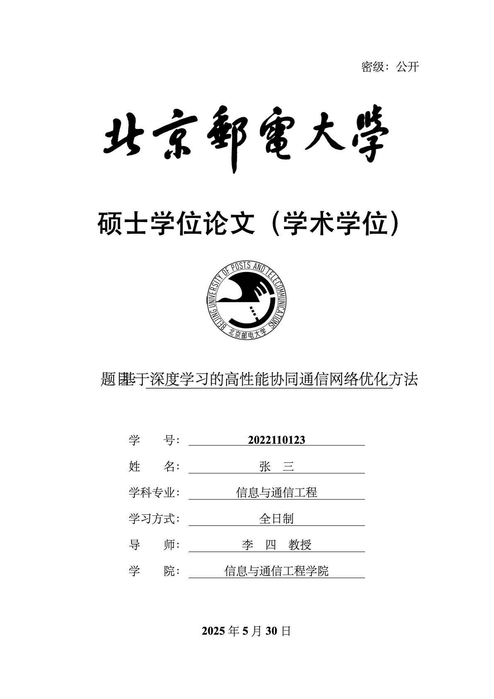
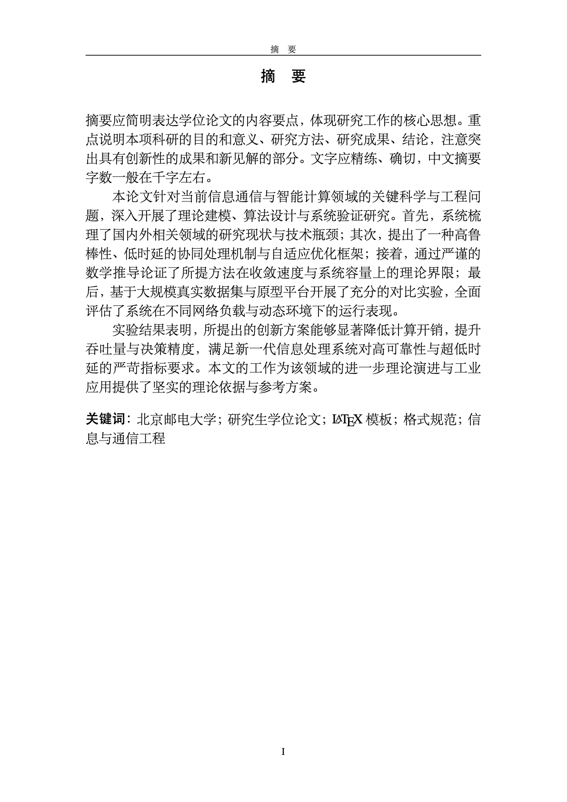
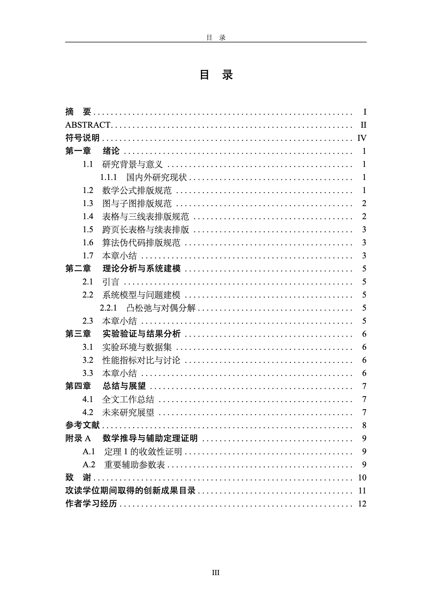
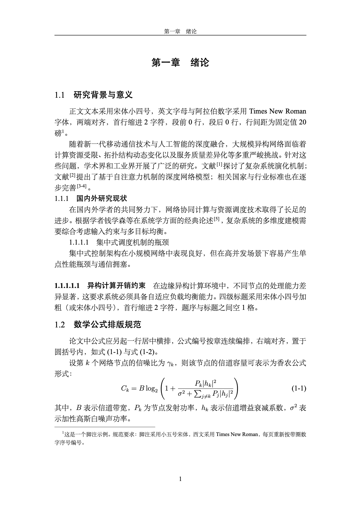
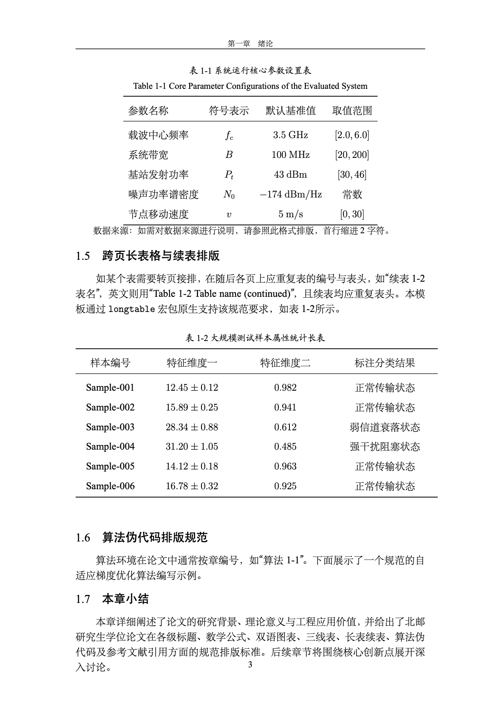
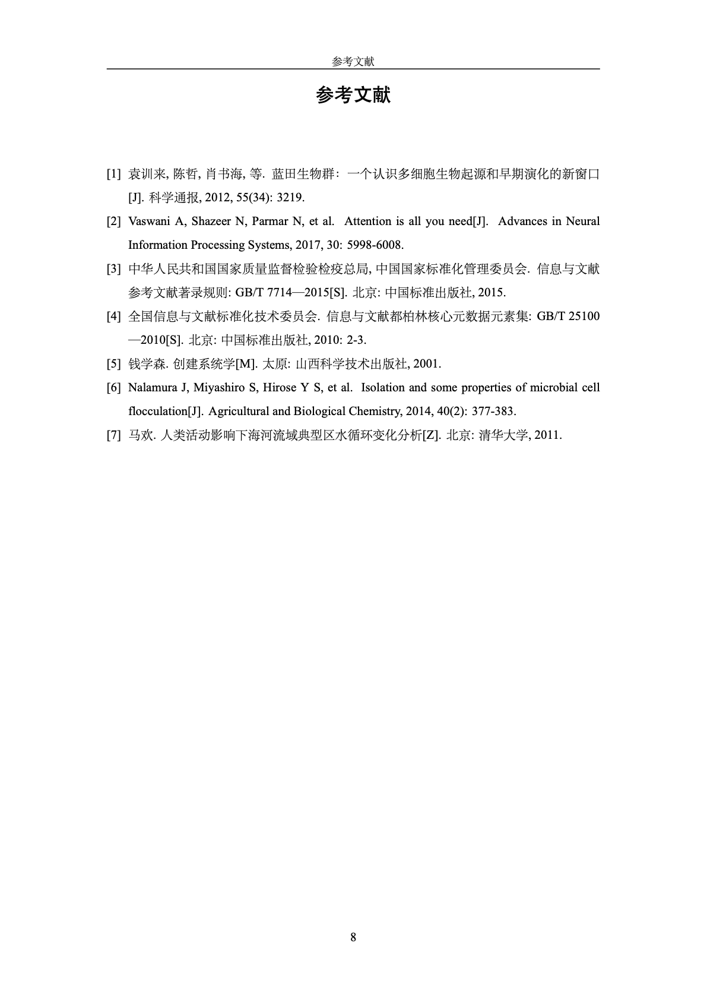

# 北京邮电大学研究生学位论文 LaTeX 模板 (2025版)

本模板严格依据**北京邮电大学研究生院 2025年1月15日 修订发布的《北京邮电大学研究生学位论文写作与制作规范》**及**《北京邮电大学研究生学位论文模板-理工科（2025年1月15日）》**编写制作，完全兼容**北京邮电大学研究生学位论文格式规范检测系统（论51 / bupt.lun51.com/GRS）**的机检规则。

适用于：
* **学术型硕士学位论文**（Master of Science / Master of Arts）
* **专业型硕士学位论文**（Master of Engineering / Professional Master）
* **学术型博士学位论文**（Doctor of Philosophy, Ph.D.）
* **专业型博士学位论文**（Doctor of Engineering, Eng.D.）

---

## 目录
- [一、快速上手编译指南](#一快速上手编译指南)
  - [1. 方式一：Overleaf（强烈推荐，免安装本地环境）](#1-方式一overleaf强烈推荐免安装本地环境)
  - [2. 方式二：Tectonic 现代化一键编译（免配宏包依赖）](#2-方式二tectonic-现代化一键编译免配宏包依赖)
  - [3. 方式三：传统本地编译 (TeX Live / VS Code / TeXstudio)](#3-方式三传统本地编译-tex-live--vs-code--texstudio)
- [二、效果预览 (Compiled PDF Showcase)](#二效果预览-compiled-pdf-showcase)
- [三、项目文件结构说明](#三项目文件结构说明)
- [四、文档类参数配置 (buptthesis)](#四文档类参数配置-buptthesis)
- [五、2025年最新规范要点与排版指南](#五2025年最新规范要点与排版指南)
- [六、纸质版封面与书脊制作指南](#六纸质版封面与书脊制作指南)
- [七、论51格式检测系统通关避坑技巧](#七论51格式检测系统通关避坑技巧)
- [八、常见问题解答 (FAQ)](#八常见问题解答-faq)

---

## 一、快速上手编译指南

### 1. 方式一：Overleaf（强烈推荐，免安装本地环境）
1. 将本仓库打包为 `.zip` 压缩文件（或直接使用本工程生成的 `bupt-thesis-latex-2025.zip`）。
2. 登录 [Overleaf](https://www.overleaf.com/)，点击 **New Project** $\rightarrow$ **Upload Project**，上传压缩包。
3. **重要设置**：点击 Overleaf 左上角 **Menu（菜单）**，在 **Compiler（编译器）** 下拉框中切换为 **`XeLaTeX`**（必须选择 XeLaTeX，以支持中文与字体宏包）。
4. 点击 **Recompile（重新编译）** 即可实时预览生成符合学校规范的高清 PDF 论文！

### 2. 方式二：Tectonic 现代化一键编译（免配宏包依赖）
如果你本地安装了 [Tectonic](https://tectonic-typesetting.github.io/)（一款现代化、无痛自动下载 CTAN 宏包的跨平台 TeX 引擎），进入项目根目录直接执行单条命令即可：
```bash
tectonic main.tex
```
Tectonic 会自动解析交叉引用、参考文献并完成多轮编译，一步输出 `main.pdf`！

### 3. 方式三：传统本地编译 (TeX Live / VS Code / TeXstudio)
#### 环境准备：
* 推荐安装官方 **TeX Live**（2021 或更新版本）或 macOS 平台的 **MacTeX**。
* 编辑器推荐使用 **VS Code**（配合 *LaTeX Workshop* 插件）或 **TeXstudio**。

#### 标准命令行编译步骤：
在工程根目录下依次执行：
```bash
xelatex main
bibtex main
xelatex main
xelatex main
```
或者直接使用 `latexmk` 一键自动化编译：
```bash
latexmk -xelatex main.tex
```

---

## 二、效果预览 (Compiled PDF Showcase)

基于 2025 年 1 月 15 日最新规范实际编译生成的 PDF 核心页面预览：

| 中文扉页 (内封首面) | 中文摘要及关键词 (四号宋体) | 论文目录 (至三级目录项) |
| :---: | :---: | :---: |
|  |  |  |

| 正文第一章 (绪论与标题) | 双语图表与三线表规范 | 参考文献著录 (GB/T 7714) |
| :---: | :---: | :---: |
|  |  |  |

---

## 二、项目文件结构说明

```
bupt-thesis-latex/
├── buptthesis.cls                # 核心文档类文件（定义版面边距、行距、字体、各级标题与页眉页脚）
├── config/
│   └── buptthesis.cfg            # 配置文件（预定义中英文固定标签、声明文本、学校信息）
├── gbt7714.sty                   # GB/T 7714-2015 参考文献宏包
├── gbt7714-numerical.bst         # GB/T 7714-2015 顺序编码制 BibTeX 样式文件
├── resources/                    # 资源目录
│   ├── name.png                  # 高清晰“北京邮电大学”毛体中文校名
│   ├── logo.png                  # 高清晰北京邮电大学校徽
│   ├── bupt_en_name_and_seal.pdf # 英文校名与校徽矢量图
│   └── gbkai-Regular.ttf         # 国标楷体字体文件（确保在任何Linux/Overleaf环境下渲染出规范楷体）
├── main.tex                      # 主文件（配置个人元数据、章节引入与正文排版架构）
├── Bib/
│   └── thesis.bib                # 参考文献数据库（包含期刊、专著、学位论文、专利、标准等典型示例）
├── Chapter/                      # 章节模块目录
│   ├── 01_cnabstract.tex         # 中文摘要及关键词（严格符合四号宋体+固定值20磅）
│   ├── 02_enabstract.tex         # 英文摘要及关键词（三号加粗+四号正文+固定值20磅）
│   ├── 03_nomenclature.tex       # 符号说明（规范三列表格）
│   ├── 10_introduction.tex       # 第一章 绪论（图表、公式、三线表、分图、长表续表、伪代码、文献引用范例）
│   ├── 20_theory.tex             # 第二章 理论分析与系统建模
│   ├── 30_experiments.tex        # 第三章 实验验证与结果分析
│   ├── 40_conclusion.tex         # 第四章 总结与展望
│   ├── 90_appendix.tex           # 附录
│   ├── 91_acknowledgements.tex   # 致谢（宋体小四号+固定值20磅）
│   ├── 92_publications.tex       # 攻读学位期间取得的创新成果目录（符合2025规范最新命名）
│   └── 93_experience.tex         # 作者学习经历（从高中阶段起的规范表格）
├── cover_print/                  # 纸质版封面/书脊套印工具
│   ├── print_cover.tex           # 预印背景纸套印封面文件
│   └── spine.tex                 # 书脊排版与打印文件
├── .latexmkrc                    # 自动化编译配置文件
└── README.md                     # 本说明文档
```

---

## 三、文档类参数配置 (buptthesis)

在 `main.tex` 的开头通过 `\documentclass[...]` 传入不同选项，可一键切换学位类别与输出模式：

| 选项名称 | 取值与含义 | 说明与默认值 |
| :--- | :--- | :--- |
| **学位级别** | `master`（硕士，默认）<br>`phd`（博士） | 控制扉页类别文字、英文封面 Dissertation/Thesis 以及偶数页页眉 |
| **学位类型** | `phil`（学术学位，默认）<br>`eng`（专业学位） | 控制显示为“硕士学位论文（学术学位）”或“硕士学位论文（专业学位）”等 |
| **培养方式** | `fulltime`（全日制，默认）<br>`parttime`（非全日制） | 显示在中文扉页个人信息栏中 |
| **输出模式** | `electronic`（电子版，默认）<br>`print`（双面打印版） | **电子版**：扉页为首页，无多余偶数空白页，适于盲审提交与论51检测；<br>**打印版**：双面印刷模式，主要部分与各章奇数页强制起排 |
| **页眉位置** | `cenhdr`（默认开启） | 2025规范明确规定“宋体小五号居中书写”，本模板已默认强制居中 |
| **数学字体** | `txmath`（可选） | 开启后加载 `newtxmath` 宏包，选用 Times 风格数学字体 |

常用示例：
* **学术型硕士（送审电子版）**：`\documentclass[master,phil,fulltime,electronic]{buptthesis}`
* **专业型硕士（送审电子版）**：`\documentclass[master,eng,fulltime,electronic]{buptthesis}`
* **学术型博士（送审电子版）**：`\documentclass[phd,phil,fulltime,electronic]{buptthesis}`
* **专业型博士（送审电子版）**：`\documentclass[phd,eng,fulltime,electronic]{buptthesis}`
* **双面打印归档纸质版**：只需将 `electronic` 改为 `print`。

---

## 四、2025年最新规范要点与排版指南

本模板针对 2025 年 1 月 15 日学校最新写作规范，实现了像素级精确还原：

### 1. 版芯尺寸与页边距
* **纸张规格**：标准 A4 纸（210mm $\times$ 297mm）。
* **页边距**：上 2.54 cm，下 2.54 cm，左 3.17 cm，右 3.17 cm，装订线 0 cm。
* **页眉距顶端**：1.5 cm；**页脚距底端**：1.75 cm。

### 2. 扉页（内封）与版权声明
* **电子版无封面**：规范明确要求研究生提交电子版本（PDF）时**不需要制作封面，扉页即为第1页**。
* **类别文字**：黑体 32 号居中加粗，严格分为四种：“硕士学位论文（学术学位）”、“博士学位论文（学术学位）”、“硕士学位论文（专业学位）”、“博士学位论文（专业学位）”。
* **题目长度限制**：包括副题与标点符号**不得超过 36 个汉字**。
* **独创性声明与授权书**：文本 100% 精确匹配 2025 规范原文字句。若已有导师和作者手写签名的扫描件 PDF，可在 `main.tex` 中使用 `\statementpage{resources/signed.pdf}` 一键整页替换。

### 3. 摘要与关键词规范
* **中文摘要**：
  * 标题：“摘\quad 要”（中间空1个全角空格），黑体三号居中，段前0行，段后1行，单倍行距。
  * 摘要正文：**四号宋体**（注意不是小四号！），两端对齐，首行缩进 2 字符，段前 0 行，段后 0 行，**固定值 20 磅**。
  * 关键词：“关键词：”黑体四号，其后关键词宋体四号，3～5个，**全角分号“；”**隔开，**末尾无标点**。
* **英文摘要**：
  * 标题：“ABSTRACT”Times New Roman 三号加粗居中，段前0行，段后2行，单倍行距。
  * 摘要正文：四号 Times New Roman，两端对齐，首行缩进 2 字符，固定值 20 磅。
  * 关键词：“KEY WORDS:”四号加粗，其后四号，**半角分号“; ”**隔开，**末尾无标点**。

### 4. 论文目录
* 标题：“目\quad 录”，黑体三号居中，单倍行距，段前 0 行，段后 2 行。
* 目录层级：严格显示到 3 级目录（章、节、小节）。
  * 一级目录项（章）：黑体小四号，两端对齐，左缩进 0 字符，固定值 20 磅。
  * 二级目录项（节）：宋体小四号，两端对齐，左缩进 2 字符，固定值 20 磅。
  * 三级目录项（小节）：宋体小四号，两端对齐，左缩进 4 字符，固定值 20 磅。
  * 点线导引符与页码右对齐。

### 5. 正文与标题层级
* **正文主体**：宋体小四号，西文 Times New Roman，两端对齐，首行缩进 2 字符，段前 0 行，段后 0 行，**固定值 20 磅**。
* **章标题（一级）**：黑体三号，居中对齐，段前 0 行，段后 2 行，单倍行距，题序与标题间空 2 格（如“第一章\quad 绪论”）。
* **二级标题（节）**：黑体四号，左对齐，首行无缩进，段前 0.5 行，段后 0.5 行，单倍行距，题序与标题间空 2 格（如“1.1\quad 标题”）。
* **三级标题（小节）**：黑体小四号，左对齐，首行无缩进，段前 0 行，段后 0 行，固定值 20 磅，题序与标题间空 2 格（如“1.1.1\quad 标题”）。
* **四级标题**：宋体小四号，两端对齐，首行缩进 2 字符，段前 0 行，段后 0 行，固定值 20 磅，题序与标题间空 2 格。

### 6. 图、表、公式与算法
* **图题**：楷体五号居中，固定值 20 磅。图序与图名间空 1 格，图名中不允许使用标点符号，图名后不加标点。支持 `\bicaption{中文图名}{English Caption}`。
* **表题**：楷体五号居中，固定值 20 磅。表序与表名间空 1 格，表名后不加标点。推荐国际通用三线表。支持跨页长表 `longtable` 并带“续表”表头。
* **图注与表注**：模板提供 `\fignote{...}` 与 `\tablenote{...}` 宏命令，宋体五号，两端对齐，首行缩进 2 字符，固定值 20 磅。
* **公式**：独立一行居中横排，按章连续编号且右端对齐，如式 (1-1)。
* **算法**：按章编号为“算法1-1”，自带规范的三线盒体与行号展示。

### 7. 页眉与页脚
* **页眉**：宋体小五号居中书写，单实线（0.75pt）。
  * 偶数页：固定为“北京邮电大学硕士学位论文”或“北京邮电大学博士学位论文”。
  * 奇数页：当前章序及章标题（正文前显示摘要、ABSTRACT、目录、符号说明；后置部分显示参考文献、致谢等）。
* **页脚与页码**：Times New Roman 五号居中书写，两侧不加“-”等修饰线。
  * 前置部分（中文摘要至正文前）：大写罗马数字（`I, II, III...`）连续编码。
  * 正文部分（第一章绪论起）：阿拉伯数字（`1, 2, 3...`）从 1 连续编码至文末。

### 8. 参考文献与后置章节
* **参考文献**：严格遵循《信息与文献 参考文献著录规则》（GB/T 7714—2015）。正文采用上标方括号编号引用 `\cite{...}`。文后内容为宋体五号，固定值 20 磅。
* **致谢**：标题“致\quad 谢”黑体三号居中，正文宋体小四号首行缩进 2 字符，固定值 20 磅。
* **攻读学位期间取得的创新成果目录**：**注意 2025 规范已去除“创新成果”上的双引号**。
* **作者学习经历**：从高中阶段开始，采用起止年月、类别、学习单位名称、学科/专业名称四列表格排版。

---

## 五、纸质版封面与书脊制作指南

在提交最终纸质装订版论文时，请前往打印店使用研究生院规定的统一预印背景纸（硕士为淡黄色亚光铜版纸，博士为深灰色亚光铜版纸）。

由于背景纸已预印校名、学位类别与校徽，**校徽及以上部分严禁重复打印**。
本模板在 `cover_print/` 目录中提供了两套配套小工具：
1. **`cover_print/print_cover.tex`**：仅在校徽下方对应位置套印论文题目、个人信息与日期，放入背景纸即可直接对位打印。
2. **`cover_print/spine.tex`**：书脊制作文件，可根据论文装订实际厚度微调纸张宽度，竖排打印论文题目、作者姓名与学号。

---

## 六、论51格式检测系统通关避坑技巧

北邮采用**论51（bupt.lun51.com/GRS）**作为研究生学位论文格式检测系统。提交前请注意以下常见扣分点：
1. **题目字数**：中文题目字数（含副标题和标点符号）**严禁超过 36 个汉字**。
2. **摘要字号**：中文摘要正文字体**必须是四号宋体**（正文是小四号，摘要比正文大半号），本模板已自动设定。
3. **关键词标点**：中文关键词之间必须用**全角分号（；）**隔开，最后一个关键词后**不要打标点**；英文关键词用**半角分号（; ）**隔开。
4. **图表题注**：图名置于图下方，表名置于表上方；图表名末尾**严禁加句号**。
5. **页码制式**：第一章前必须是大写罗马数字，第一章必须从阿拉伯数字 1 重新起计。
6. **送审请选电子版**：送审提交 PDF 时，确保 `\documentclass[...,electronic]{buptthesis}`，避免产生偶数空白页影响页码连续性检测。

---

## 七、常见问题解答 (FAQ)

#### Q1: 在 Overleaf 编译时提示找不到字体或数学符号报错？
**A**: 请检查左上角 **Menu（菜单）** 中的 **Compiler** 是否设置成了 **`XeLaTeX`**。Overleaf 默认的 pdfLaTeX 不支持中文宏包。

#### Q2: 终版论文需要附上签字的“独创性声明”，如何处理？
**A**: 将导师和作者签好字的纸质声明页扫描为单页 PDF（如 `resources/signed_statement.pdf`），然后在 `main.tex` 中取消注释 `\statementpage{resources/signed_statement.pdf}` 即可，编译时会自动无缝替换。

#### Q3: 为什么目录中“摘  要”或各章节标题在本地初次编译时显示为 `??` 或页码不准？
**A**: 这是 LaTeX 的交叉引用特性。首次编译只会提取标号，完整编译流程需要运行：`xelatex` $\rightarrow$ `bibtex` $\rightarrow$ `xelatex` $\rightarrow$ `xelatex`（共 3 次 xelatex + 1 次 bibtex），目录即可完全对齐。

#### Q4: 本地 Windows / Mac 编译时楷体显示异常？
**A**: 本模板已在 `resources/` 目录中贴心内嵌了开源国标楷体字库 `gbkai-Regular.ttf`，不管是在 Linux（Overleaf）、Windows 还是 macOS 下，都能自动优先加载，彻底杜绝操作系统自带字体差异导致的格式检测问题。

---

**祝各位北邮学子顺利完成学位论文撰写与答辩，毕业顺利，前程似锦！**
